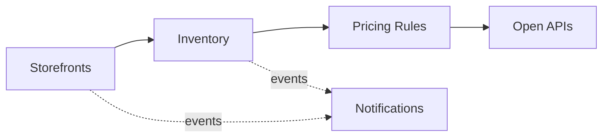

# Domain Model and Bounded Contexts

Ubiquitous language and context design (view VP-4). Domain-standard concepts are mapped
normatively in `../domain/domain-standards.md` (CR-5).

## Ubiquitous language (selected terms)

| Term | Meaning |
|---|---|
| **Storefront** | A sales front for one market and currency |
| **Inventory pool** | The guarded available-units account of a SKU |
| **Reservation** | One channel draw against a SKU's inventory pool |
| **Pricing rule** | A decision rule binding a segment to order and returns envelopes |
| **Product** | A catalogue item with a minor-unit price |
| **Fraud score** | A transparent 0-100 checkout risk score |

## Bounded contexts and invariants

### Storefronts — `storefront-service`
Storefront registry: one front per market and currency. Lifecycle: `ACTIVE` → transitions
suspend, reactivate. Shopper personal data is minimized: this core works with storefront, product and inventory data; payment card data never enters the platform (certified PSP boundary, PCI DSS adjacency).

### Inventory — `inventory-service`
Guarded inventory pools per SKU and the channel reservations against them. **Invariant (ADR-0004): sellable inventory is never oversold — a reservation that exceeds available units is rejected (422) and records nothing, on every channel.** Consumption records are
append-only evidence; a rejected operation records nothing.

### Pricing Rules — `pricing-rules-service`
Decision rules binding customer segments to order-size and returns envelopes. Only ACTIVE rules decide; evaluation order is by priority; every decision
is ALLOWED / DEGRADED / DENIED with the matched rule and a human-readable reason.

### Products — `product-catalog-service`
Product catalogue with minor-unit prices.

### Notifications — `notification-service`
Delivery trail for audit; recipients are never logged.

## Context map

